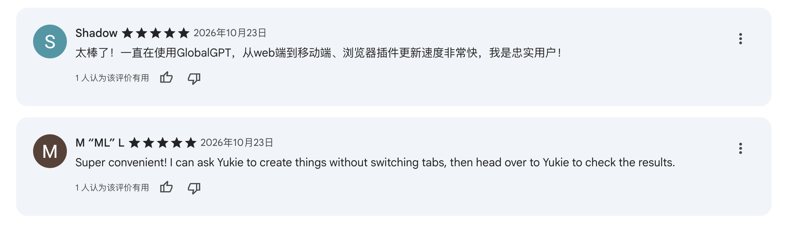
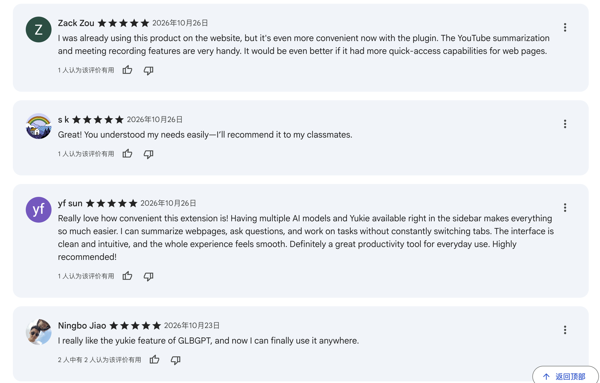
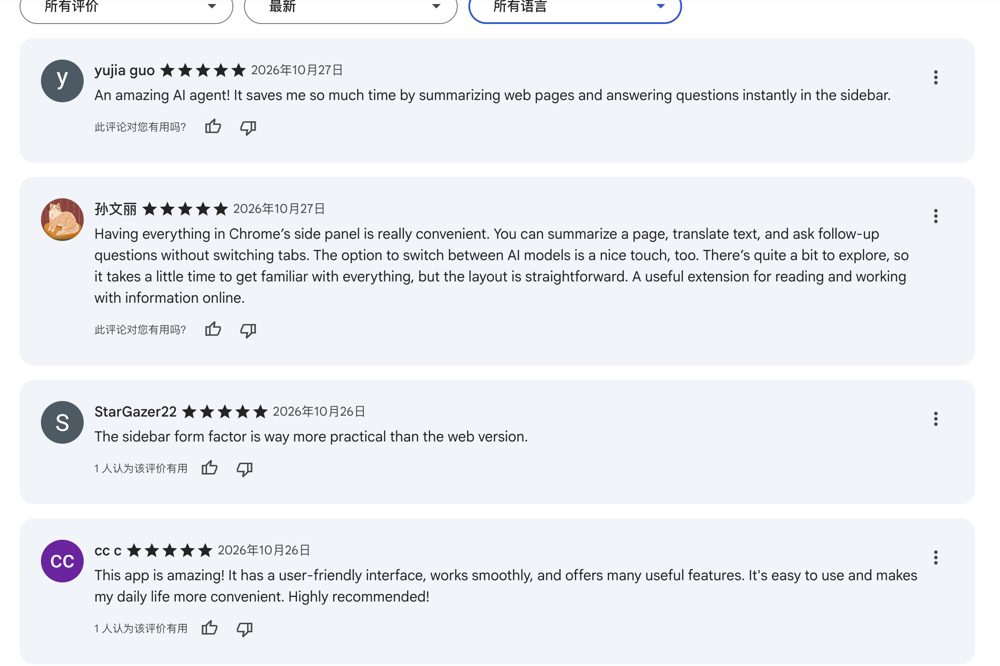

  <picture>
    <source media="(prefers-reduced-motion: reduce) and (max-width: 600px) and (prefers-color-scheme: dark)" srcset="./banner-mobile-dark.svg?v=subtle-ai-j-v1">
    <source media="(prefers-reduced-motion: reduce) and (max-width: 600px)" srcset="./banner-mobile-light.svg?v=subtle-ai-j-v1">
    <source media="(prefers-reduced-motion: reduce) and (prefers-color-scheme: dark)" srcset="./banner-dark.svg?v=subtle-ai-j-v1">
    <source media="(prefers-reduced-motion: reduce)" srcset="./banner-light.svg?v=subtle-ai-j-v1">
    <source media="(max-width: 600px) and (prefers-color-scheme: dark)" srcset="./banner-mobile-dark.gif?v=subtle-ai-j-v1">
    <source media="(max-width: 600px)" srcset="./banner-mobile-light.gif?v=subtle-ai-j-v1">
    <source media="(prefers-color-scheme: dark)" srcset="./banner-dark.gif?v=subtle-ai-j-v1">
    
  </picture>

  <picture>
    <source media="(prefers-color-scheme: dark)" srcset="./identity-dark.svg">
    
  </picture>

👋 精算学在读，正在做面向海外用户的 Agent 与多端 AI 产品。从需求、设计到开发和数据复盘，喜欢把想法亲手做出来。

  <a href="https://jazzy179.github.io/Jazzy179/">🌐 交互作品</a> ·
  <a href="./portfolio.pdf">📄 PDF 作品集</a> ·
  <a href="https://www.glbgpt.com/video-edit">🎬 Video Editor</a> ·
  <a href="mailto:jazzyzhong@163.com">✉️ 邮箱</a>

<h2>What can I do 我能做什么</h2>

从用户需求出发，做交互、推进开发，再用真实使用数据继续改进。

<table>
  <tbody>
    <tr>
      <td width="50%" valign="top">
        
<code>01 / AGENT</code>

        <h3>🤖 Agent 场景与功能设计</h3>
        
把用户目标拆成具体功能，查找与整理任务技能（Skills），设计工作流，参与提示词优化和模型效果评测。

      </td>
      <td width="50%" valign="top">
        
<code>02 / EXPERIENCE</code>

        <h3>🎨 多端体验与交互设计</h3>
        
面向 Web、移动端、Mac 与 Chrome 插件，设计功能入口、操作路径，以及任务进行中和完成后的交互。

      </td>
    </tr>
    <tr>
      <td width="50%" valign="top">
        
<code>03 / BUILD</code>

        <h3>🛠️ 产品落地与动手开发</h3>
        
独立出方案、画原型、协同研发与验收；用 Codex 辅助开发 Video Editor、图片和视频详情页，推进上线与维护。

      </td>
      <td width="50%" valign="top">
        
<code>04 / DATA</code>

        <h3>📊 数据分析与产品迭代</h3>
        
结合 PostHog 与业务数据库做使用复盘，分析俄罗斯市场使用与付费路径；复现未完成的任务，形成优化需求与验收条件。

      </td>
    </tr>
  </tbody>
</table>

<h2>📊 产品使用与交付 移动端 Agent · 28 天</h2>

从有多少人进入，到有没有开始使用、是否保存结果，分别观察。

<table>
  <thead>
    <tr><th scope="col">使用数据</th><th scope="col">这代表什么</th></tr>
  </thead>
  <tbody>
    <tr>
      <th scope="row"><strong>3,057 人</strong> 进入移动端 Agent</th>
      <td>其中 <strong>956 人发过消息，占进入人数的 31.3%</strong>，把“进入页面”和“开始使用”分开观察。</td>
    </tr>
    <tr>
      <th scope="row"><strong>5,139 次</strong> 用户发送请求</th>
      <td>由 <strong>956 位发送用户</strong>发起，平均每位发送用户发起 <strong>5.4 次</strong>请求。</td>
    </tr>
    <tr>
      <th scope="row"><strong>1,656 次</strong> 明确选择生图 / 生视频场景</th>
      <td>占全部发送的 <strong>32.2%</strong>：生图 <strong>1,064 次 / 284 人</strong>，生视频 <strong>592 次 / 221 人</strong>。两类人数可能重叠，分别统计。</td>
    </tr>
    <tr>
      <th scope="row"><strong>810 次</strong> 成功保存结果</th>
      <td><strong>844 次</strong>保存操作中，成功比例 <strong>96.0%</strong>；另有 <strong>334 人查看过结果</strong>，体现结果的查看与保存使用情况。</td>
    </tr>
  </tbody>
</table>

2026.09.29—10.26，手机原生 App；包含环境未标明的记录，未剔除内部 / 测试账号。<a href="#data-definitions">查看统计说明 ↓</a>

<h2>🔎 我怎样用数据做产品判断</h2>

<table>
  <thead><tr><th scope="col">问题</th><th scope="col">关键发现</th><th scope="col">对应的产品动作</th></tr></thead>
  <tbody>
    <tr>
      <th scope="row">🎬 剪辑体验 Video Editor</th>
      <td><strong>39 / 56 个会话（69.6%）</strong>的首轮诉求是创意包装或基础剪辑；<strong>99 次素材导入调用有 90 次失败</strong>，其中 64 次文件不可见、26 次路径格式不符。</td>
      <td>从用户真正要“动手剪”出发，形成<strong>素材可用性预检、路径校验、失败后恢复</strong>建议；效果仍需上线后验证。</td>
    </tr>
    <tr>
      <th scope="row">🤖 任务验收 外部应用连接</th>
      <td><strong>141 轮</strong> Connector 相关任务中，<strong>118 轮（83.7%）</strong>被标为系统结束，只有 <strong>45 轮（31.9%）</strong>观察到成功外部调用。</td>
      <td>将“系统结束”和“外部操作执行”分开验收；结合案例整理<strong>能力预检、授权后继续执行等 6 项 Connector 优化建议</strong>。</td>
    </tr>
    <tr>
      <th scope="row">🧭 导航改版 Yukie 左侧栏</th>
      <td>在 <strong>1,804 位</strong>左栏点击用户中，<strong>70.8%</strong>用过新建对话；Skills 与 Connectors 也分别覆盖 <strong>26.2% / 22.6%</strong>。</td>
      <td>支持突出主入口、收拢低频功能的设计方向；同时在二级导航保留有人使用的 Skills / Connectors。<strong>左侧栏重设计已进入开发。</strong></td>
    </tr>
  </tbody>
</table>

  
📐 数据怎么算？展开看统计范围与限制

  
<strong>移动端：</strong>2026.09.29 00:00—10.27 00:00，北京时间；只含 iOS / Android 原生 App，发送次数按事件编号去重。956 位发送用户均属于本期 3,057 位访客。5.4 = 5,139 ÷ 956；32.2% =（1,064 + 592）÷ 5,139；96.0% = 810 ÷ 844。

  
<strong>保存结果：</strong>844 次操作中，810 次成功、15 次失败、19 次到统计结束时还没有返回结果。334 位查看结果的用户不能直接与保存次数拼成同一条转化路径。

  
<strong>Video Editor：</strong>2026.09.15 首条可查用户消息—10.22 20:20，只统计编辑器内向 Yukie 发过消息的 43 人、56 个会话，不能代表编辑器全部访客。需求按每个会话首条消息人工归为一类；导入失败是调用次数，同一个人可能反复重试。

  
<strong>任务验收：</strong>采用 10.19 的第二轮分析快照，样本来自最近 3,000 个会话，并排除最近 6 小时才开始的任务。141 轮为其中 Connector 相关任务；没有观察到成功调用，不足以直接判定所有用户目标均失败。

  
<strong>左侧栏：</strong>采用 10.22 更新后的新 Yukie 左栏口径，2026.09.22 00:02—10.22 00:02，10,907 次点击、1,804 位点击用户。比例是“点击过某入口的人 / 点击过左栏的人”，各入口可以重叠，不是曝光点击率；未沿用混入旧导航的 39,472 次口径。

  
<strong>当前边界：</strong>产品使用、文件交付和分析发现分别展示；改版后的转化提升、留存提升、收入提升尚缺少验证，因此没有写成个人成果。

<h2>🗣️ 用户需求：从反馈里找方向 Video Editor · Chrome</h2>

与 CEO 共同发起用户访谈，将反馈用于 Video Editor 迭代与当前的再设计。以下提炼三个具体需求方向。

<table>
  <thead><tr><th scope="col">用户反馈与使用场景</th><th scope="col">提炼出的需求与验证方向</th></tr></thead>
  <tbody>
    <tr>
      <td><blockquote>“这是我目前必须手动维护的部分，也是整个过程中最消耗我时间的事情。”</blockquote>长片创作者 · 指角色、场景、镜头状态与修改记录</td>
      <td><strong>长片创作需要持续的项目记录。</strong> 先验证镜头清单、角色 / 场景档案和素材关联，能否减少手工记录与跨表查找；保留用户对镜头和费用的最终确认。</td>
    </tr>
    <tr>
      <td><blockquote>“根据音乐节拍自动同步剪辑点” “自动匹配转场和特效”</blockquote>视频创作反馈 · 另有二次创作、自定义数字人等期望</td>
      <td><strong>减少重复剪辑操作。</strong> 把自动卡点、转场匹配列为候选方向，结合现有素材导入问题，观察用户从导入到导出的完整流程，再判断优先级。</td>
    </tr>
    <tr>
      <td><blockquote>“在任何浏览器标签页或网页上都可以直接调用。”</blockquote>浏览器助手需求 · 所提供材料中的中文节选</td>
      <td><strong>在当前网页就能发起任务。</strong> 与已上线的侧栏、插件与云端联动路径相对应；继续观察上下文是否需要重复复制，以及任务发起后能否找到结果。</td>
    </tr>
  </tbody>
</table>

以上为匿名用户文字反馈的中文节选；右侧具体方向仍需验证，尚未逐项确认为已上线功能。<a href="#user-feedback-context">展开看场景与材料说明 ↓</a>

  
📝 更多使用线索与反馈背景

  
<strong>创作者希望把什么交给 AI：</strong>根据剧本生成镜头清单，持续维护已确认的角色、场景和制作状态，找到对应素材并组装镜头；剧本、创意、最终审批和花费确认仍由用户掌握。这是用户期待的流程，不能写成已完成的长片制作能力。

  
<strong>已经发生的使用：</strong>一位用户自述在 iPhone App 上通过图生视频为活动制作宣传片，并认可一个订阅聚合多个模型的价值。这能说明具体场景与用户感知，尚不足以计算节省的成本或时间。

  
<strong>其他待核实的方向：</strong>Windows / 平板适配、按项目保存资料与技能、外部工具连接、数字人和更低的生成成本。需要进一步确认使用频率、替代办法和付费意愿，再决定优先顺序。

  
<strong>材料说明：</strong>来自本次提供的两段文字及三张截图；材料可能出自同一用户，不按材料数量计算受访人数。未展示个人姓名、工作室及完整邮件。<a href="#chrome-feedback">下方商店评价</a>记录的是上线后的实际使用反馈，与这里的功能期望分别呈现。

<h2>💬 Chrome 插件：用户怎么说</h2>

★★★★★ <strong>10 条五星评价样本</strong>2026.10.23—10.27 · 来自本次提供的商店截图

其中 5 条明确提到侧栏或减少切换页面，3 条提到网页摘要；这些主题可以重叠。以下保留原文片段，再说明对应的使用价值。

<table>
  <thead><tr><th scope="col">评价原文节选</th><th scope="col">用户认可的具体价值</th></tr></thead>
  <tbody>
    <tr>
      <td><blockquote>“I can ask Yukie to create things without switching tabs, then head over to Yukie to check the results.”</blockquote>2026.10.23 · 五星评价</td>
      <td><strong>少切换页面，任务还能继续。</strong> 在浏览器里发起创作，再去 Yukie 查看结果，对应插件与云端联动的使用路径。</td>
    </tr>
    <tr>
      <td><blockquote>“The interface is clean and intuitive, and the whole experience feels smooth.”</blockquote>2026.10.26 · 五星评价</td>
      <td><strong>侧栏中的操作更顺手。</strong> 该评价同时提到网页摘要、问答、多模型与 Agent，说明这些能力放在同一侧栏中的实际便利。</td>
    </tr>
    <tr>
      <td><blockquote>“It would be even better if it had more quick-access capabilities for web pages.”</blockquote>2026.10.26 · 五星评价中的改进建议</td>
      <td><strong>好评里也有下一步线索。</strong> 用户希望增加网页快捷操作；另一条评价提到熟悉全部功能需要时间，后续可验证快捷入口与首次使用引导。</td>
    </tr>
  </tbody>
</table>

<a href="https://jazzy179.github.io/Jazzy179/browser-agent.html">🧩 查看插件交互 ↗</a> · <a href="#core-systems">查看我的项目职责 ↓</a>

  
🗂️ 查看评价截图与样本说明

  
3 张截图中可辨认出 10 条不同评价，均为五星。这里只描述已提供的样本，不代表商店总评价数、整体评分或全体用户满意度。“侧栏 / 少切页”计入 5 条，“网页摘要”计入 3 条；同一评价可同时出现两个主题。未将 YouTube 摘要计入网页摘要。

  

  

  

<h2>🧩 核心系统与我的职责</h2>

<table>
  <tbody>
    <tr>
      <td width="50%" valign="top">
        
<code>01 / AGENT</code> <code>已上线</code>

        <h3>🤖 Yukie / 多端 Agent</h3>
        
<strong>让同一个 Agent，在手机、Mac 与浏览器中都能使用。</strong>

        
<strong>我负责：</strong>移动端从没有 Agent 区域开始，设计首页、PPT / 生图 / 生视频交互、上传与任务状态；适配外部服务连接（Connector）与任务技能（Skills）。

        
Mac 客户端从 0 到 1 设计两版，加入 <code>Task / Agent / Create</code> 模式切换；推进 Chrome 插件与云端联动。

        
<strong>使用与反馈：</strong>移动端 28 天有 956 位发送用户、5,139 次发送请求；Chrome 插件已有 <a href="#chrome-feedback">10 条五星评价样本</a>，包含对侧栏和少切页的具体认可。

        
<a href="https://jazzy179.github.io/Jazzy179/mobile-yukie.html">移动端交互 ↗</a> · <a href="https://jazzy179.github.io/Jazzy179/mac-client.html">Mac 客户端 ↗</a> · <a href="https://jazzy179.github.io/Jazzy179/browser-agent.html">Chrome 插件 ↗</a>

      </td>
      <td width="50%" valign="top">
        
<code>02 / CREATION</code> <code>持续迭代</code>

        <h3>🎬 Video Editor / AI 视频创作</h3>
        
<strong>从功能设计到页面开发，独立推进视频创作产品。</strong>

        
<strong>我负责：</strong>需求拆解、功能与 UI 设计、前端页面开发、研发协同和上线维护，持续更新素材与交互。

        
已迭代两版，搭建数据面板并做使用复盘，把观察到的问题带入下一轮优化。

        
与 CEO 共同发起用户访谈，将反馈用于 Video Editor 迭代，继续推进当前版本再设计。<a href="#user-needs">查看用户需求与验证方向 ↑</a>

        
<strong>阶段记录：</strong>截至 10.22，编辑器内 Agent 助手覆盖 <strong>43 人、56 个有效会话、205 条用户指令</strong>；20 人在 23 个会话中收到 <strong>53 个视频文件</strong>。文件交付尚不等于最终成片通过用户验收。

        
<a href="https://www.glbgpt.com/video-edit">体验在线产品 ↗</a> · <a href="https://jazzy179.github.io/Jazzy179/video-editor-demo.mp4">查看交互录屏 ↗</a>

      </td>
    </tr>
    <tr>
      <td width="50%" valign="top">
        
<code>03 / EXPERIENCE</code> <code>已上线</code>

        <h3>🖼️ Created / Asset 详情页</h3>
        
<strong>让生成后的图片与视频，更方便找到信息和继续操作。</strong>

        
<strong>问题：</strong>Created 按钮繁多、顺序混乱；Asset 缺少继续处理素材所需的信息与操作。问题来自用户反馈和页面观察。

        
<strong>我负责：</strong>独立提出方案、设计原型与交互，重排按钮、补全信息，并使用 Codex 辅助完成开发。

        
<strong>交付结果：</strong>覆盖图片、视频共 4 组页面；进入正式代码库并通过代码审核。

        
<a href="./portfolio.pdf">查看作品集 ↗</a>

      </td>
      <td width="50%" valign="top">
        
<code>04 / EVALUATION</code> <code>推进中</code>

        <h3>🔬 用户任务复现与数据分析</h3>
        
<strong>找出用户没完成任务的原因，再变成可执行的需求。</strong>

        
<strong>我负责：</strong>结合 PostHog、业务数据库与用户反馈，分析进入、发送、查看结果、保存和系统处理结束的记录，使用 Codex 辅助分析与复盘。

        
人工复现复杂任务，判断问题来自交互、外部服务连接、模型输出还是权限，并明确优化方案与验收条件。

        
<strong>当前产出：</strong><strong>17 项优化建议</strong>，覆盖 Connector 6 项、网站 5 项、Research 6 项；分析结论经负责人审核，继续推进产品改进。

        
<a href="#data-decisions">查看数据如何支持产品判断 ↑</a>

      </td>
    </tr>
  </tbody>
</table>

## 📚 AI 产品基础与学习笔记

| AI 产品 | Agent 系统 | 数据与评测 | 量化与数据科学 |
| :-- | :-- | :-- | :-- |
| 场景设计、信息架构、原型、多端适配、商业化与上线复盘 | 工作流、Prompt、模型评测、Skills、Connector、任务状态 | PostHog、业务数据库、任务复现、漏斗拆解、指标口径 | Python、NumPy、pandas、时间序列、因子与回测，正在系统学习 |

## 🛠️ 工程活动与公开作品

我会把能公开展示的部分保留为原型、页面和录屏，不公开内部代码、用户信息或未发布路线图。

| 作品 | 内容 |
| :-- | :-- |
| [移动端 Yukie 交互 ↗](https://jazzy179.github.io/Jazzy179/mobile-yukie.html) | Agent 首页、生成入口、Connector / Skills 与任务状态 |
| [Mac 客户端 ↗](https://jazzy179.github.io/Jazzy179/mac-client.html) | Chatbot、Agent、生图生视频和模式切换 |
| [Chrome 插件 ↗](https://jazzy179.github.io/Jazzy179/browser-agent.html) | 浏览器上下文、侧边栏 Agent 与云端联动 |
| [Video Editor 录屏 ↗](https://jazzy179.github.io/Jazzy179/video-editor-demo.mp4) | 视频生成产品的真实交互路径 |
| [完整 PDF 作品集 ↗](./portfolio.pdf) | 项目背景、过程、数据和复盘 |

## 🌱 产品之外

- **华福证券研究所 · 电子组：** 参与消费电子行业研究、公司与产业链资料整理、信息跟踪和研究支持。
- **对外经济贸易大学 · 精算学：** 正在补充 Python、金融数据清洗、基础因子、回测和研究报告写作，希望用公开项目检验自己是否适合继续深入量化研究。
- **当前的工作偏好：** 喜欢用户需求、页面设计、模型评测和推进落地，也愿意处理数据清洗、调试和反复推翻假设。

## 📬 联系方式

- 交互作品：[查看交互作品](https://jazzy179.github.io/Jazzy179/)
- 邮箱：[jazzyzhong@163.com](mailto:jazzyzhong@163.com)
- PDF：[查看完整作品集](./portfolio.pdf)

把用户目标拆成可执行的产品，让 Agent 能使用、能验证、能继续改进。

